<div align="center">

<a href="https://bavlywilliam.github.io/Bavly-William-Portfolio"></a>

<h1>Bavly William</h1>

<p><b>AI implementation and automation</b> &nbsp;·&nbsp; Cairo, Egypt</p>

<p><i>Connecting business processes, technology, and creative execution.</i></p>

<p>
  <a href="https://bavlywilliam.github.io/Bavly-William-Portfolio"></a>
</p>

<p>
  <a href="https://www.linkedin.com/in/bavly-william-b5a27822a"></a>
  <a href="https://www.youtube.com/@BavlyWilliamAI"></a>
  <a href="https://www.behance.net/bavlywilliam"></a>
  <a href="mailto:bavlywilliamwork@gmail.com"></a>
</p>

<a href="https://bavlywilliam.github.io/Bavly-William-Portfolio">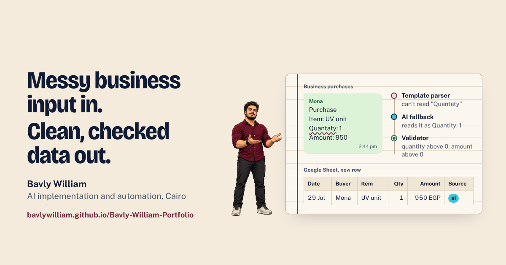</a>

<p><b>Live site:</b> <a href="https://bavlywilliam.github.io/Bavly-William-Portfolio">https://bavlywilliam.github.io/Bavly-William-Portfolio</a></p>

<sub>Open to remote AI automation roles, relocation to the UAE or Qatar, and freelance builds for small businesses.</sub>

<br>

<a href="#how-i-work">How I work</a> &nbsp;·&nbsp;
<a href="#featured-projects">Projects</a> &nbsp;·&nbsp;
<a href="#at-work">At work</a> &nbsp;·&nbsp;
<a href="#videos">Videos</a> &nbsp;·&nbsp;
<a href="#stack">Stack</a> &nbsp;·&nbsp;
<a href="#how-this-site-is-built">How it's built</a> &nbsp;·&nbsp;
<a href="#maintainer-guide">Maintainer guide</a>

</div>

## How I work

<table>
  <tr>
    <td valign="top" width="25%"><h3>Diagnose before building</h3><sub>Audited 100+ sales chats before automating any of them. The problem was slow replies and missing prices, not a missing bot.</sub></td>
    <td valign="top" width="25%"><h3>Rules first, AI second</h3><sub>Scripted rules answer the predictable chat questions without calling a model, checked by 330+ automated tests. Gemini only gets what the rules can't handle, which keeps cost and surprises down.</sub></td>
    <td valign="top" width="25%"><h3>Never trust the model</h3><sub>Every AI answer passes the same validator as a hand-typed message before anything is written, and AI rows are labelled for spot checks.</sub></td>
    <td valign="top" width="25%"><h3>Prove the outcome</h3><sub>A recurring report went from about 2 hours to under 10 minutes. Every number here is one I can explain, including how it was measured.</sub></td>
  </tr>
</table>

## Featured projects

Built hands-on with AI coding agents (Claude Code). Every project has a case study: the problem, the design decisions, what broke and what it still can't do.

<table>
  <tr>
    <td width="50%" valign="top">
      <a href="https://bavlywilliam.github.io/Bavly-William-Portfolio/case-whatsapp.html">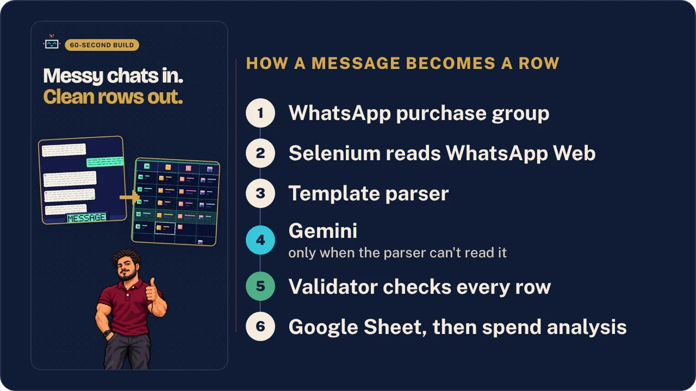</a>
      <h3>WhatsApp purchase logger</h3>
      <p> &nbsp;<sub>Freelance client, small business</sub></p>
      <p>Reads a client's WhatsApp purchase group and logs every purchase to Google Sheets, where an analysis tab shows top spender against budget, top vendor and top-spending project. A rule-based parser reads the template. Gemini reads only what the rules can't, and its answer passes the same validator before anything is written.</p>
      <p><sub><b>Stack</b> &nbsp;Python · Selenium · Google Sheets API · OAuth · Gemini API</sub></p>
      <p><a href="https://bavlywilliam.github.io/Bavly-William-Portfolio/case-whatsapp.html"><b>Case study</b></a> &nbsp;·&nbsp; <a href="https://github.com/BavlyWilliam/Whatsapp-accounting-automation">Code</a> &nbsp;·&nbsp; <a href="https://www.youtube.com/shorts/1Zm951PmB_0">49-second video</a></p>
    </td>
    <td width="50%" valign="top">
      <a href="https://bavlywilliam.github.io/Bavly-William-Portfolio/case-parla-system.html">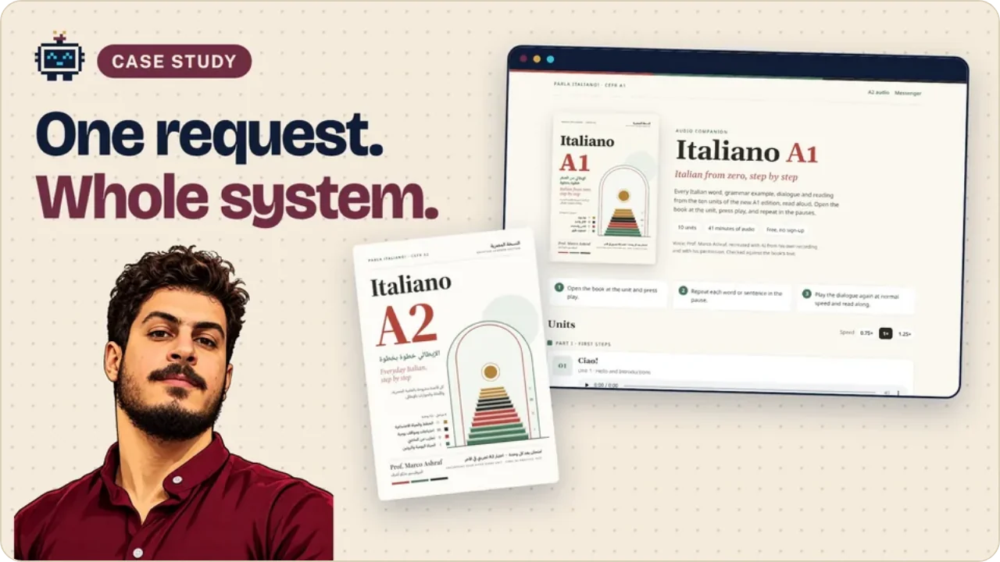</a>
      <h3>Parla Italiano: marketing, creative and AI sales assistant</h3>
      <p> &nbsp;<sub>Language-course business I co-run</sub></p>
      <p>I own everything except the teaching: content, creative, Meta ads and sales. After auditing 100+ sales chats, I built a Messenger assistant whose scripted answers, checked by 330+ automated tests, handle the predictable questions without a model. Only the rest goes to Gemini (Groq as backup), with price guardrails and a human handoff.</p>
      <p><sub><b>Stack</b> &nbsp;Content strategy · Meta Ads · Creative production · Python · FastAPI · Messenger Platform · Gemini API · Groq API · pytest</sub></p>
      <p><a href="https://bavlywilliam.github.io/Bavly-William-Portfolio/case-parla-system.html"><b>Case study</b></a> &nbsp;·&nbsp; <a href="https://app.notion.com/p/Parla-Italiano-Building-an-end-to-end-learning-and-sales-experience-404b29d974f781cdaeb2f79785ba122a">Notion write-up</a> &nbsp;·&nbsp; <a href="https://www.youtube.com/watch?v=8Q2z6JJwGhY">Sales assistant video</a> &nbsp;·&nbsp; <a href="https://www.youtube.com/watch?v=yesqCWwKWEQ">Case study video</a></p>
    </td>
  </tr>
  <tr>
    <td width="50%" valign="top">
      <a href="https://bavlywilliam.github.io/Bavly-William-Portfolio/case-audio-companion.html">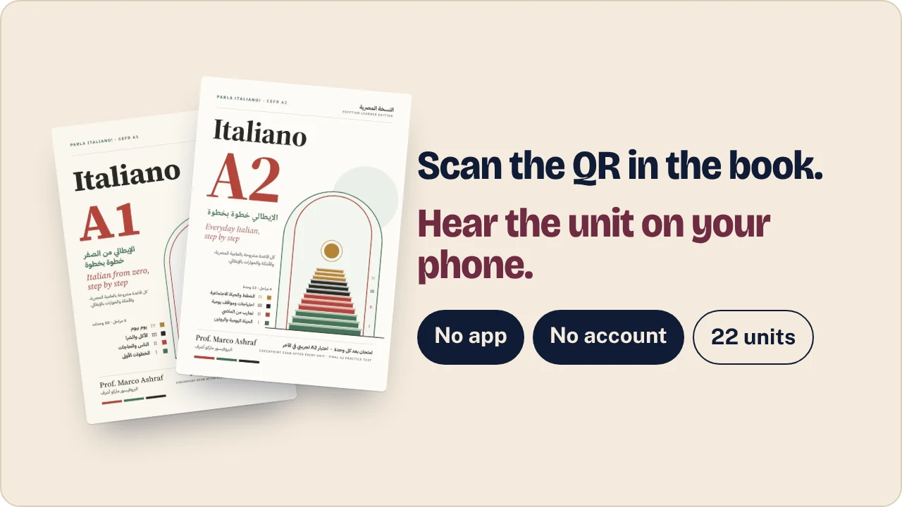</a>
      <h3>Parla Italiano audio companion</h3>
      <p> &nbsp;<sub>For a printed Italian course book</sub></p>
      <p>Book owners scan a QR code printed in the book and get that unit's audio on their phone. No app, no account, no download. Printed links never change, so books already sold keep working.</p>
      <p><sub><b>Stack</b> &nbsp;HTML · JavaScript · GitHub Pages · Cloudflare R2 · Python</sub></p>
      <p><a href="https://bavlywilliam.github.io/Bavly-William-Portfolio/case-audio-companion.html"><b>Case study</b></a> &nbsp;·&nbsp; <a href="https://bavlywilliam.github.io/Audio-Books-website/">Live site</a> &nbsp;·&nbsp; <a href="https://github.com/BavlyWilliam/Audio-Books-website">Code</a></p>
    </td>
    <td width="50%" valign="top">
      <a href="https://bavlywilliam.github.io/Bavly-William-Portfolio/case-voice-kit.html">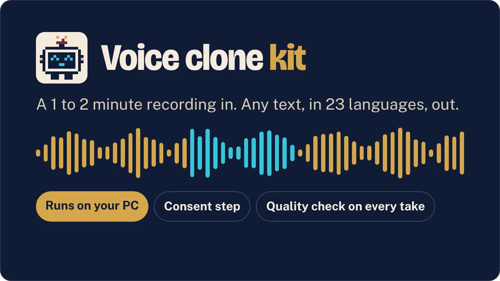</a>
      <h3>Voice clone kit</h3>
      <p> &nbsp;<sub>Personal project, used to produce the course audio</sub></p>
      <p>Clones a voice from a 1 to 2 minute recording and reads any text in 23 languages, on your own PC with nothing uploaded. A consent step comes first, and every take gets an automatic quality check.</p>
      <p><sub><b>Stack</b> &nbsp;Python · Gradio · PyTorch · Chatterbox (open source)</sub></p>
      <p><a href="https://bavlywilliam.github.io/Bavly-William-Portfolio/case-voice-kit.html"><b>Case study</b></a> &nbsp;·&nbsp; <a href="https://github.com/BavlyWilliam/voice-clone-kit">Code</a></p>
    </td>
  </tr>
  <tr>
    <td width="50%" valign="top">
      <a href="https://bavlywilliam.github.io/Bavly-William-Portfolio/case-orchestrator.html">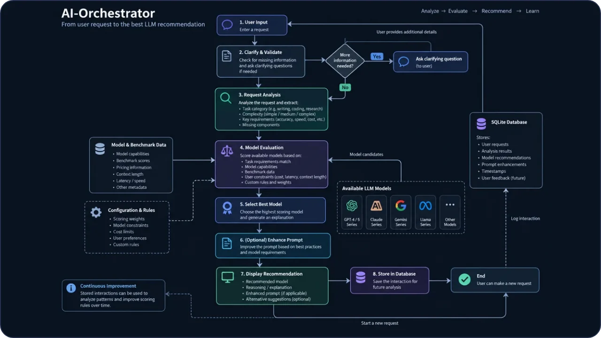</a>
      <h3>AI model orchestrator</h3>
      <p> &nbsp;<sub>Personal project</sub></p>
      <p>Asks a follow-up question when a request is missing something important, then recommends an AI model with its reasons, using live benchmark data. Gemini's answers are parsed into Pydantic models and rejected if they don't fit. Every run is logged to SQLite.</p>
      <p><sub><b>Stack</b> &nbsp;Python · Gemini API · Pydantic · SQLite · Artificial Analysis API</sub></p>
      <p><a href="https://bavlywilliam.github.io/Bavly-William-Portfolio/case-orchestrator.html"><b>Case study</b></a> &nbsp;·&nbsp; <a href="https://github.com/BavlyWilliam/AI-Orchestrator">Code</a></p>
    </td>
    <td width="50%" valign="top">
      <a href="https://bavlywilliam.github.io/Bavly-William-Portfolio">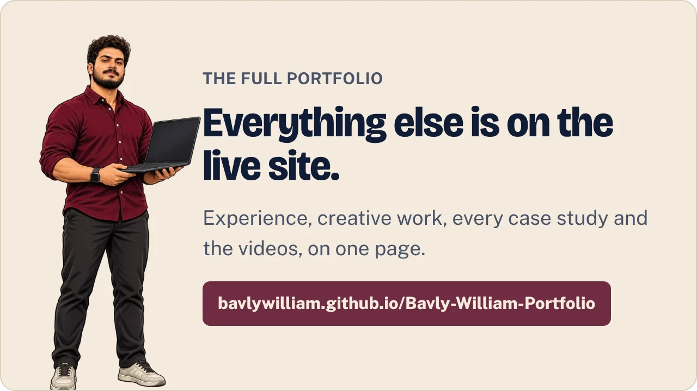</a>
      <h3>The full portfolio</h3>
      <p>Experience, creative work, every case study and the videos, on one page.</p>
      <p><a href="https://bavlywilliam.github.io/Bavly-William-Portfolio"><b>bavlywilliam.github.io/Bavly-William-Portfolio</b></a></p>
    </td>
  </tr>
</table>

## At work


Tools I built for my own team at Concentrix on the Microsoft account, the final line of escalation support for Microsoft partners. Described without internal data, screenshots or system names.

| Tool | What it does | Built with |
|---|---|---|
| **AI case taxonomy agent** | Puts every incoming case in the same category, whoever handles it. The rules live in Excel, so they change without rebuilding the agent. | Copilot Studio, Excel |
| **Team knowledge agent** | Answers partner-management questions from the team's own knowledge. Removed an estimated 20% of recurring manual work. | Microsoft Copilot |
| **Fair case assignment** | Matches each case to language, severity and line of business. Rule-based on purpose: predictable, auditable, free per case. | Excel VBA |
| **Standard call-intake form** | Fixed fields turn every call into the same note structure, so details aren't skipped. | HTML, JavaScript |
| **Team reporting data model** | A refreshable KPI view for team leadership, replacing reports consolidated by hand. | Power Query, Power BI |
| **Legacy report export** | Added data export and date filtering to a legacy internal system. A recurring report went from about 2 hours to under 10 minutes. | JavaScript |

## Videos

<table>
  <tr>
    <td valign="top" width="50%"><a href="https://www.youtube.com/watch?v=yesqCWwKWEQ">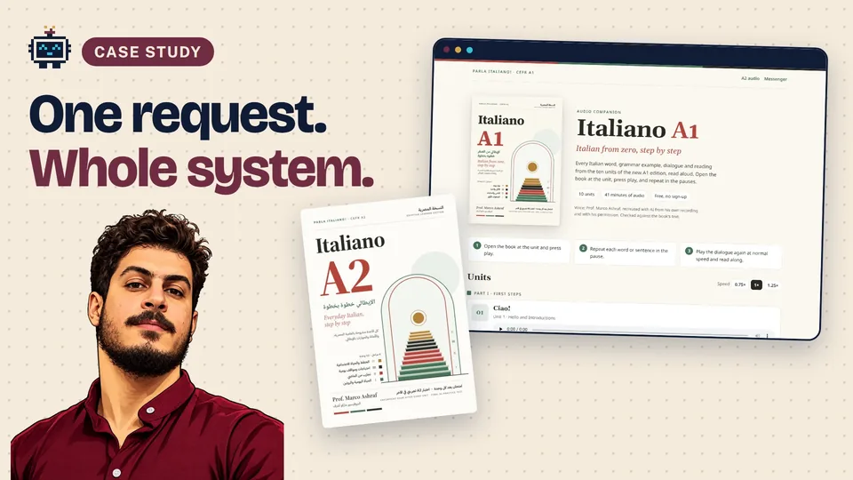</a></td>
    <td valign="top" width="50%"><a href="https://www.youtube.com/watch?v=8Q2z6JJwGhY"></a></td>
  </tr>
  <tr>
    <td valign="top"><sub><b>Parla Italiano case study</b><br>One request, a whole system</sub></td>
    <td valign="top"><sub><b>AI sales assistant</b><br>How I built it, and why it doesn't send every message to AI</sub></td>
  </tr>
</table>

<table>
  <tr>
    <td valign="top"><a href="https://www.youtube.com/shorts/1Zm951PmB_0">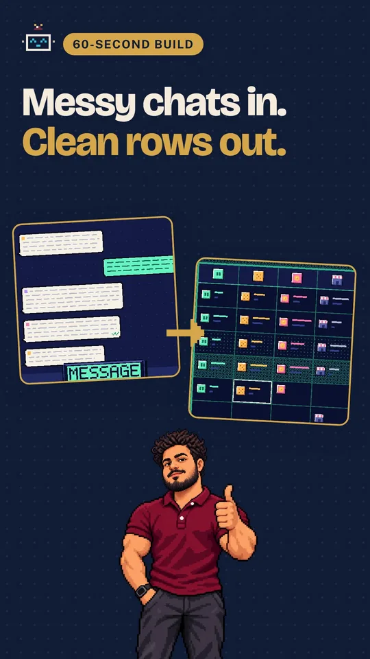</a></td>
    <td valign="top"><a href="https://www.youtube.com/shorts/DMXJ6AwHf7s">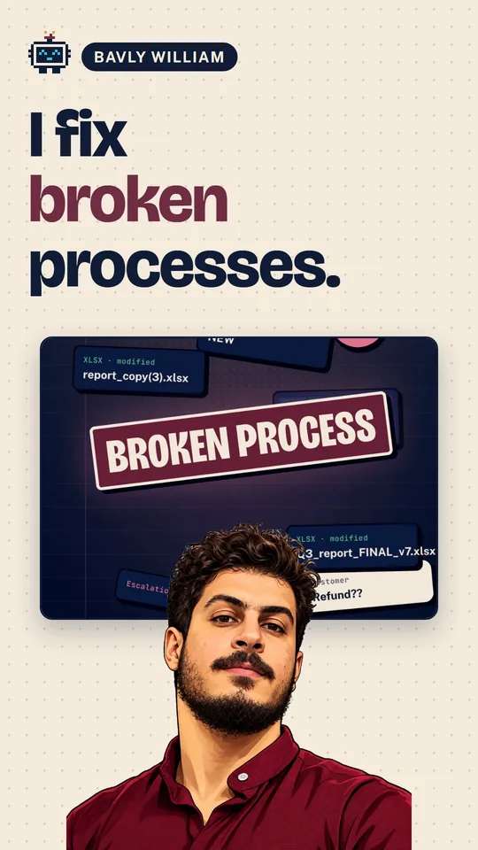</a></td>
    <td valign="top"><a href="https://www.youtube.com/shorts/sgzUw8TQIVU">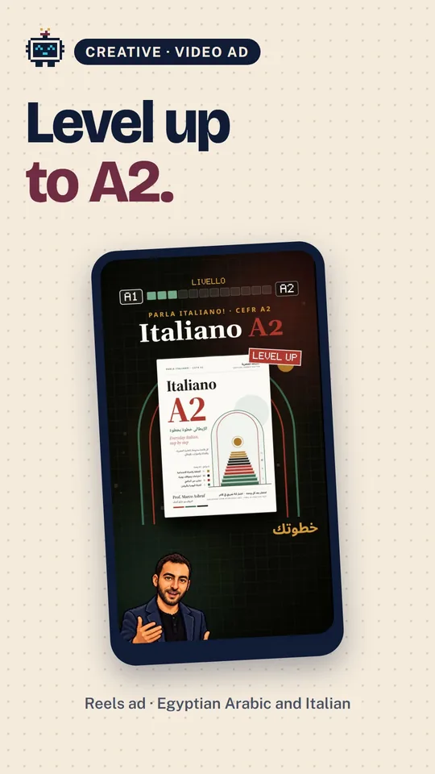</a></td>
  </tr>
  <tr>
    <td valign="top"><sub><b>WhatsApp logger</b><br>How it works, 49 s</sub></td>
    <td valign="top"><sub><b>Who I am</b><br>What I fix, 38 s</sub></td>
    <td valign="top"><sub><b>A2 video ad</b><br>Egyptian Arabic</sub></td>
  </tr>
</table>

<a href="https://www.youtube.com/@BavlyWilliamAI">Every video on YouTube</a> &nbsp;·&nbsp; <a href="https://www.behance.net/bavlywilliam">Creative work on Behance</a>

## Stack

| | |
|---|---|
| **Automation and AI** |       |
| **APIs and data** |      |
| **Microsoft** |       |
| **Web** |     |
| **Learning now** |    |

## How this site is built


One page that collects my projects, code, videos, creative work and experience, so a hiring manager or client gets the whole picture from one link. Two HTML templates, one stylesheet, one script, one data file and a pre-render script.

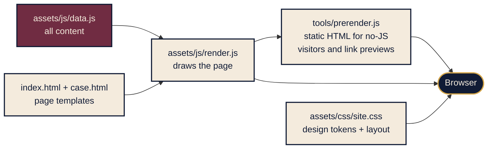

**Engineering choices**

- **Content and code are separate.** Adding a project means editing `data.js`, never HTML or JavaScript. Same idea as `clients.json` in the WhatsApp purchase logger.
- **No markup injection.** `render.js` inserts every piece of text with `textContent`, never `innerHTML`, so nothing in `data.js` can inject markup into the page.
- **Case studies come free.** Any project with a `caseStudy` block gets its own page at `case-<id>.html`, with its own title and link-preview text, and each case study links to the next one. Older `case.html?p=<id>` links keep working.
- **Works without JavaScript.** `node tools/prerender.js` runs the real `render.js` in Node and writes the result into the HTML, so search engines, link previews and visitors without JavaScript see every project. In the browser, `render.js` draws the page again from `data.js`, so a forgotten pre-render never shows stale content to normal visitors.
- **Fast by default.** YouTube loads from `youtube-nocookie.com` only when a visitor presses play, and each video's poster is a plain link to YouTube until then. Fonts are self-hosted.
- **No analytics, no trackers.**

### Component map

| Path | What it does | Edit it? |
|---|---|---|
| `assets/js/data.js` | Every project, video, image, job and link, including the YouTube channel | **Yes, this is the only file you edit** |
| `assets/js/render.js` | Reads `data.js` and builds the sections | No |
| `tools/prerender.js` | Writes the sections into the HTML and creates the `case-<id>.html` pages. Run `node tools/prerender.js` after editing `data.js` | Run it, don't edit it |
| `index.html` | Home page template, SEO and link-preview tags, the hero demo. The sections between the tags are filled in by the pre-render | Rarely, outside the sections |
| `case.html` | Template for every case study, and the page behind older `case.html?p=<project id>` links | No |
| `case-<id>.html` | One static page per case study, generated | No, regenerate them |
| `assets/css/site.css` | Colours, type, layout, the hero animation | Rarely |
| `assets/img/` | Avatars, project images, `og.png` link-preview image, the BAV logo and robot icon | Add images here |
| `assets/img/readme/` | The project cards and robot tile used only in this README | When a featured project changes |
| `assets/fonts/` | Self-hosted Bricolage Grotesque and Public Sans | No |
| `assets/cv/` | Put your CV PDF here (create the folder) | Yes |
| `.nojekyll` | Tells GitHub Pages to serve files as they are | No |

### Status labels

Every project carries one. Each label has to be defensible in an interview.

| Status | Use it when |
|---|---|
|  | People use it today |
|  | It runs end to end, but nobody relies on it daily |
|  | It proves the idea and has rough edges |
|  | It is being built now |

Every number on the site and in this README must match the CV and be something I can explain in an interview, including how it was measured.

## Maintainer guide

<details>
<summary><b>Data model</b>: projects, case studies, videos, creative work</summary>

<br>

#### `projects[]`

| Field | Type | Example | Notes |
|---|---|---|---|
| `id` | string | `"whatsapp"` | Unique, lowercase, no spaces. Also the case-study URL |
| `group` | `"work"` \| `"independent"` | `"work"` | Which list it appears in (see `projectGroups`) |
| `confidential` | boolean | `true` | Internal employer tool: compact row, no code links, no stack line |
| `draft` | boolean | `true` | Hidden from the site until you delete the line |
| `title` | string | `"WhatsApp purchase logger"` | |
| `context` | string | `"Freelance client, small business"` | Who it was for |
| `status` | `"live"` \| `"working"` \| `"prototype"` \| `"progress"` | `"working"` | See [status labels](#status-labels) |
| `summary` | string | | What it does, for a non-technical reader |
| `how` | string | | How it works, for a technical reader |
| `stack` | string[] | `["Python", "Selenium"]` | |
| `image` | string | `"assets/img/x.webp"` | Optional, about 900px wide |
| `imageAlt` | string | | Describe the image |
| `links.code` | URL | | Optional |
| `links.live` | URL | | Optional |
| `links.notion` | URL | | Optional, an external write-up |
| `links.video` | video `id` | `"whatsapp-explainer"` | Optional, must match a `videos[].id` that has a source |
| `caseStudy` | object | | Optional. Creates the case-study page (below) |

#### `caseStudy`

| Field | Type | What to write |
|---|---|---|
| `problem` | string | The business problem in plain words. Who hurt, and how |
| `constraints` | string[] | Budget, tools, people, rules you had to respect |
| `flow` | string[] | The pipeline, in order. Rendered as a numbered sequence |
| `decisions` | `{choice, why}[]` | Each design choice and the reason. This is what interviewers probe |
| `broke` | `{issue, fix}[]` | Real bugs and how you fixed them. Leave `[]` if none |
| `results` | string[] | Only things you can prove. Numbers must match the CV |
| `limits` | string[] | What it can't do. Saying this first earns trust |
| `next` | string[] | What you'd build next |

Empty lists hide their section.

#### `videos[]`

| Field | Notes |
|---|---|
| `id` | Unique. Projects link to it with `links.video` |
| `title` | Shown under the player |
| `youtubeId` | The part after `v=` in the YouTube link, or after `/shorts/` for a Short |
| `vertical` | `true` for Shorts and other 9:16 videos: they get a tall frame and one grid column |
| `poster` | Optional image shown before play, e.g. `assets/img/video-<id>.webp` (about 960 px). Without it, YouTube's thumbnail is used |
| `file` | Or a local `.mp4` path, under 50 MB |

A video with neither `youtubeId` nor `file` is hidden. The whole Videos section and its menu link stay hidden until at least one video has a source. A project whose `links.video` points at a video with a source shows "Watch the video", and its case-study page embeds the player under the header.

#### `creative[]`

One set per Behance project, newest first.

| Field | Notes |
|---|---|
| `id` | Short id, used for the set's heading anchor |
| `title` | Set heading, e.g. "Souk el Grana: launch posts for a handmade bag brand" |
| `note` | One or two sentences under the heading: what it is and your part |
| `link` | The Behance project page. Every image in the set links here, plus a "See the project on Behance" link |
| `size` | `[width, height]` of the images in pixels, so the grid keeps their shape |
| `items[]` | `{ image, alt, caption, size }`: `image` is a path in `assets/img/creative/`, `alt` describes the image for screen readers, `caption` is optional text under it, `size` only for an image shaped differently from the rest of its set |

A set with no `items` is hidden.

#### `experience[]`, `skills`, `credentials`

Plain text, kept identical to the CV.

</details>

<details>
<summary><b>Recipes</b>: add a project, case study, video or creative work</summary>

<br>

**Add a project in five minutes**

1. Export one image (about 900px wide, `.webp`) into `assets/img/`.
2. Open `assets/js/data.js`, copy an existing block inside `projects`, paste it where you want it in the list.
3. Change every field. Empty strings hide links you don't have.
4. Run `node tools/prerender.js` (Node 18 or newer), preview locally (below), then commit and push every file it changed.

**Add a case study**

Add a `caseStudy` block to the project in `data.js` (copy the WhatsApp one). Run `node tools/prerender.js`: it creates `case-<id>.html`, and a "Read the case study" link appears on the project's row. The page footer links to the next case study automatically. If you delete a case study, the script lists the `case-<id>.html` file to delete.

**Add a video**

1. Upload to YouTube as Public or Unlisted, with embedding allowed.
2. Copy the ID from the link: `https://www.youtube.com/watch?v=AbC123xYz` and `https://www.youtube.com/shorts/AbC123xYz` both give `AbC123xYz`.
3. Paste it into the matching `youtubeId` in `data.js`. For a Short, keep `vertical: true`.
4. Optional: export the video's thumbnail at about 960 px wide as `.webp` into `assets/img/` and set `poster`.

The player loads YouTube only when the visitor presses play, which keeps the page fast. With a `poster`, nothing at all loads from YouTube until then. The channel link (`links.youtube`) appears in the contact block and under the Videos section.

**Add creative work**

Publish the project on Behance first. Export each image 720px wide as `.webp` into `assets/img/creative/`, then copy the Souk el Grana set in `creative`, put it first, and change the text, `link` (the Behance project URL), `size` and `items`. Run `node tools/prerender.js`.

**Add a project to this README**

Export a card at 1280 x 720 px as `.webp` into `assets/img/readme/` (keep the rounded corners and the cream or navy background so the grid stays consistent), then copy one `<td>` cell in [Featured projects](#featured-projects) and change the text and links. Keep the grid at two cells per row.

</details>

<details>
<summary><b>Preview locally and deploy</b></summary>

<br>

**Preview locally**

```bash
cd Bavly-William-Portfolio
python -m http.server 8000
```

Open <http://localhost:8000>. Opening `index.html` by double-clicking also works.

**Deploy**

This is a GitHub Pages **project site**, so its address is the account address plus the repository name.

1. Repository: `BavlyWilliam/Bavly-William-Portfolio`, public.
2. Run `node tools/prerender.js`, then push to `main`.
3. Settings, Pages: source "Deploy from a branch", branch `main`, folder `/ (root)`.
4. The site goes live at <https://bavlywilliam.github.io/Bavly-William-Portfolio> within a few minutes.

All links inside the site are relative, so it works under any repository name. Only these contain the full address and must change if the repository is ever renamed: `og:url`, `og:image` and the `url` in the JSON-LD block of `index.html`, `og:image` in `case.html`, the address printed on `assets/img/og.png` and on `assets/img/readme/card-live-site.webp`, and the links in this README. Renaming also changes the address on both CVs.

</details>

## Brand

BAV Automations palette. The tokens live at the top of `assets/css/site.css`; change a colour there and it changes everywhere.

| | Role | Colour | Hex | Use it for |
|---|---|---|---|---|
|  | Core | Navy | `#101B35` | Text on light surfaces, dark sections, outlines |
|  | Core | Burgundy | `#702C42` | Primary buttons, the BAV wordmark, accents |
|  | Core | Cream | `#F4EBDD` | Page background, text on navy |
|  | Personality | Gold | `#D5A64A` | Small highlights: "AUTOMATIONS", underlines on navy, sparks |
|  | Robot and tech only | Cyan | `#36C5D9` | The robot's face, AI and tech details |

Green appears only as a functional colour (the "Live" status and the chat bubble), not as a brand colour.

<details>
<summary><b>Contrast rules</b> (WCAG ratios measured on these exact colours)</summary>

<br>

| Pairing | Ratio | Allowed |
|---|---|---|
| Navy on cream | 14.4 | Yes, body text |
| Burgundy on cream | 8.4 | Yes, text and buttons |
| Cream on navy | 14.4 | Yes |
| Gold on navy | 7.6 | Yes |
| Cyan on navy | 8.2 | Yes |
| Burgundy on navy | 1.7 | **No.** Outline burgundy in cream when it must sit on navy |
| Gold on cream | 1.9 | **No** as text. Fills and decoration only |
| Cyan on cream | 1.8 | **No** as text. Fills only, with navy text on top |

</details>

<details>
<summary><b>Logo files</b></summary>

<br>

| File | Use |
|---|---|
| `assets/img/bav-automations-logo.svg` | Full logo, transparent background. Works on navy and on cream (it carries its own navy outline) |
| `assets/img/bav-automations-logo-navy.svg` | Full logo on a navy tile, for places where you can't control the background |
| `assets/img/bav-automations-logo-cream.svg` | Full logo on a cream tile with rounded corners. Profile pictures, video outros, light documents |
| `assets/img/bav-automations-logo-cream-2048.png` | The cream tile as a 2048 px PNG, for apps that don't accept SVG (Behance, LinkedIn, video editors) |
| `assets/img/favicon.svg` | Robot icon, 16 x 16 grid. Browser tab and site header |
| `assets/img/readme/robot-tile.svg` | The robot on a cream tile, so it stays visible in GitHub's dark mode. Top of this README |

The SVG logos are rebuilt square by square in the brand palette, so they stay sharp at any size and weigh about 11 KB. The `brand` block in `data.js` controls where the logo appears.

</details>

<br>

<div align="center">

<a href="https://bavlywilliam.github.io/Bavly-William-Portfolio">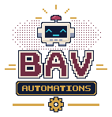</a>

<h3>Have a process that eats your team's week?</h3>

<p>Tell me what comes in, where it needs to end up, and what goes wrong today.</p>

<p>
  <a href="mailto:bavlywilliamwork@gmail.com"></a>
  <a href="https://www.linkedin.com/in/bavly-william-b5a27822a"></a>
  <a href="https://bavlywilliam.github.io/Bavly-William-Portfolio"></a>
</p>

<p><a href="https://bavlywilliam.github.io/Bavly-William-Portfolio"><b>https://bavlywilliam.github.io/Bavly-William-Portfolio</b></a></p>

<sub>Freelance builds run under my studio name, BAV Automations.</sub><br>
<sub>Fonts: <a href="https://github.com/ateliertriay/bricolage">Bricolage Grotesque</a> and <a href="https://github.com/uswds/public-sans">Public Sans</a>, SIL Open Font Licence, licence files in <code>assets/fonts/</code>. Illustrations: my own AI-generated avatar set.</sub>

</div>
