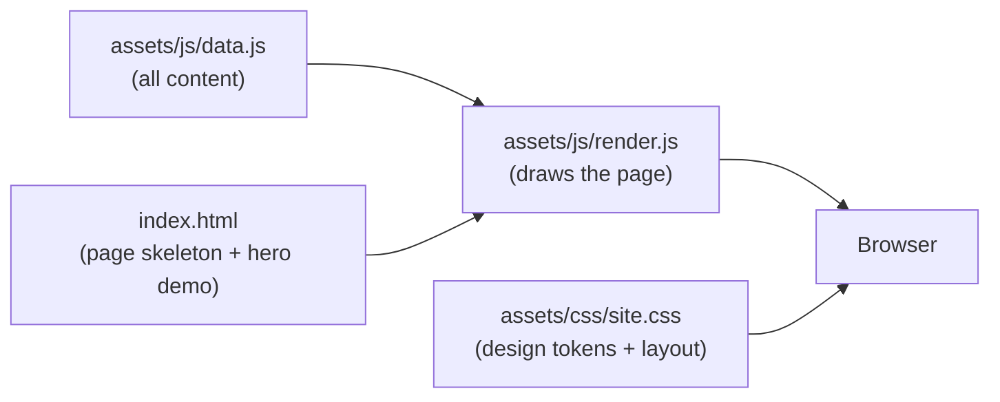

<div align="center">

# Bavly William | Portfolio

**AI implementation and automation. Messy business input in, clean, checked data out.**

[](https://bavlywilliam.github.io/)


</div>

---

## Table of contents

- [What this is](#what-this-is)
- [How it works](#how-it-works)
- [Component map](#component-map)
- [Data model](#data-model)
- [Add a project in five minutes](#add-a-project-in-five-minutes)
- [Add a case study](#add-a-case-study)
- [Add a video](#add-a-video)
- [Add creative work](#add-creative-work)
- [Preview locally](#preview-locally)
- [Deploy](#deploy)
- [Brand](#brand)
- [Honesty rules](#honesty-rules)
- [Credits](#credits)

---

## What this is

One page that collects my projects, code, videos, creative work and experience, so a hiring manager or client gets the whole picture from one link.

It is a static site with no build step and no framework: two HTML templates, one stylesheet, one script and one data file. Every project with a `caseStudy` block gets its own page at `case.html?p=<id>` automatically.

## How it works



Content and code are separate on purpose, the same way `clients.json` is separate from the code in the WhatsApp purchase logger. Adding a project never means touching HTML or JavaScript.

`render.js` inserts every piece of text with `textContent`, never `innerHTML`, so nothing in `data.js` can inject markup into the page.

## Component map

| Path | What it does | Edit it? |
|---|---|---|
| `assets/js/data.js` | Every project, video, image, job and link | **Yes, this is the only file you edit** |
| `assets/js/render.js` | Reads `data.js` and builds the sections | No |
| `index.html` | Home page skeleton, SEO and link-preview tags, the hero demo | Rarely |
| `case.html` | One template for every case study, chosen by `?p=<project id>` | No |
| `assets/css/site.css` | Colours, type, layout, the hero animation | Rarely |
| `assets/img/` | Avatars, project images, `og.png` link-preview image, the BAV logo and robot icon | Add images here |
| `assets/fonts/` | Self-hosted Bricolage Grotesque and Public Sans | No |
| `assets/cv/` | Put your CV PDF here (create the folder) | Yes |
| `.nojekyll` | Tells GitHub Pages to serve files as they are | No |

## Data model

### `projects[]`

| Field | Type | Example | Notes |
|---|---|---|---|
| `id` | string | `"whatsapp"` | Unique, lowercase, no spaces. Also the case-study URL |
| `group` | `"work"` \| `"independent"` | `"work"` | Which list it appears in (see `projectGroups`) |
| `confidential` | boolean | `true` | Internal employer tool: compact row, no code links, no stack line |
| `draft` | boolean | `true` | Hidden from the site until you delete the line |
| `title` | string | `"WhatsApp purchase logger"` | |
| `context` | string | `"Freelance client, small business"` | Who it was for |
| `status` | `"live"` \| `"working"` \| `"prototype"` \| `"progress"` | `"working"` | See [honesty rules](#honesty-rules) |
| `summary` | string | | What it does, for a non-technical reader |
| `how` | string | | How it works, for a technical reader |
| `stack` | string[] | `["Python", "Selenium"]` | |
| `image` | string | `"assets/img/x.webp"` | Optional, about 900px wide |
| `imageAlt` | string | | Describe the image |
| `links.code` | URL | | Optional |
| `links.live` | URL | | Optional |
| `links.notion` | URL | | Optional, an external write-up |
| `links.video` | video `id` | `"whatsapp-explainer"` | Optional, must match a `videos[].id` that has a source |
| `caseStudy` | object | | Optional. Creates the case-study page (below) |

### `caseStudy`

| Field | Type | What to write |
|---|---|---|
| `problem` | string | The business problem in plain words. Who hurt, and how |
| `constraints` | string[] | Budget, tools, people, rules you had to respect |
| `flow` | string[] | The pipeline, in order. Rendered as a numbered sequence |
| `decisions` | `{choice, why}[]` | Each design choice and the reason. This is what interviewers probe |
| `broke` | `{issue, fix}[]` | Real bugs and how you fixed them. Leave `[]` if none |
| `results` | string[] | Only things you can prove. Numbers must match the CV |
| `limits` | string[] | What it can't do. Saying this first earns trust |
| `next` | string[] | What you'd build next |

Empty lists hide their section.

### `videos[]`

| Field | Notes |
|---|---|
| `id` | Unique. Projects link to it |
| `title` | Shown under the player |
| `youtubeId` | The part after `v=` in the YouTube link |
| `file` | Or a local `.mp4` path, under 50 MB |

A video with neither `youtubeId` nor `file` is hidden. The whole Videos section and its menu link stay hidden until at least one video has a source.

### `creative[]`

| Field | Notes |
|---|---|
| `title` | Caption |
| `image` | Path in `assets/img/` |
| `link` | The Behance project page |

### `experience[]`, `skills`, `credentials`

Plain text, kept identical to the CV.

## Add a project in five minutes

1. Export one image (about 900px wide, `.webp`) into `assets/img/`.
2. Open `assets/js/data.js`, copy an existing block inside `projects`, paste it where you want it in the list.
3. Change every field. Empty strings hide links you don't have.
4. Preview locally (below), then commit and push.

## Add a case study

Add a `caseStudy` block to the project in `data.js` (copy the WhatsApp one). A "Read the case study" link appears on its row and the page exists at `case.html?p=<id>`. The page footer links to the next case study automatically.

## Add a video

1. Upload to YouTube as Public or Unlisted.
2. Copy the ID from the link, e.g. `https://www.youtube.com/watch?v=AbC123xYz` gives `AbC123xYz`.
3. Paste it into the matching `youtubeId` in `data.js`.

The player loads YouTube only when the visitor presses play, which keeps the page fast.

## Add creative work

Export each piece at about 900px wide as `.webp` into `assets/img/`, then add a block to `creative` with the Behance project URL as `link`.

## Preview locally

```bash
cd BavlyWilliam.github.io
python -m http.server 8000
```

Open <http://localhost:8000>. Opening `index.html` by double-clicking also works.

## Deploy

1. Create a public repository named exactly `BavlyWilliam.github.io`.
2. Push these files to `main`.
3. Settings, Pages: source "Deploy from a branch", branch `main`, folder `/ (root)`.
4. The site goes live at <https://bavlywilliam.github.io/> within a few minutes. Existing project sites such as `/Audio-Books-website/` keep working.

## Brand

BAV Automations palette. The tokens live at the top of `assets/css/site.css`; change a colour there and it changes everywhere.

| Role | Colour | Hex | Use it for |
|---|---|---|---|
| Core | Navy | `#101B35` | Text on light surfaces, dark sections, outlines |
| Core | Burgundy | `#702C42` | Primary buttons, the BAV wordmark, accents |
| Core | Cream | `#F4EBDD` | Page background, text on navy |
| Personality | Gold | `#D5A64A` | Small highlights: "AUTOMATIONS", underlines on navy, sparks |
| Robot and tech only | Cyan | `#36C5D9` | The robot's face, AI and tech details |

Contrast rules (WCAG ratios measured on these exact colours):

| Pairing | Ratio | Allowed |
|---|---|---|
| Navy on cream | 14.4 | Yes, body text |
| Burgundy on cream | 8.4 | Yes, text and buttons |
| Cream on navy | 14.4 | Yes |
| Gold on navy | 7.6 | Yes |
| Cyan on navy | 8.2 | Yes |
| Burgundy on navy | 1.7 | **No.** Outline burgundy in cream when it must sit on navy |
| Gold on cream | 1.9 | **No** as text. Fills and decoration only |
| Cyan on cream | 1.8 | **No** as text. Fills only, with navy text on top |

Green appears only as a functional colour (the "Live" status and the chat bubble), not as a brand colour.

Logo files:

| File | Use |
|---|---|
| `assets/img/bav-automations-logo.svg` | Full logo, transparent background. Works on navy and on cream (it carries its own navy outline) |
| `assets/img/bav-automations-logo-navy.svg` | Full logo on a navy tile, for places where you can't control the background |
| `assets/img/favicon.svg` | Robot icon, 16 x 16 grid. Browser tab and site header |

Both logos are rebuilt square by square in the brand palette, so they stay sharp at any size and weigh about 11 KB. The `brand` block in `data.js` controls where the logo appears.

The icon (`assets/img/favicon.svg`) is the BAV robot drawn on a 16 x 16 pixel grid, so it stays sharp in a browser tab and at any larger size. The same file is the logo in the site header.

## Honesty rules

| Status | Use it when |
|---|---|
| Live | People use it today |
| Working build | It runs end to end, but nobody relies on it daily |
| Prototype | It proves the idea and has rough edges |
| In progress | It is being built now |

Every number on the site must match the CV and be something I can explain in an interview, including how it was measured.

## Credits

- Fonts: [Bricolage Grotesque](https://github.com/ateliertriay/bricolage) and [Public Sans](https://github.com/uswds/public-sans), SIL Open Font Licence, licence files in `assets/fonts/`.
- Illustrations: my own AI-generated avatar set.
